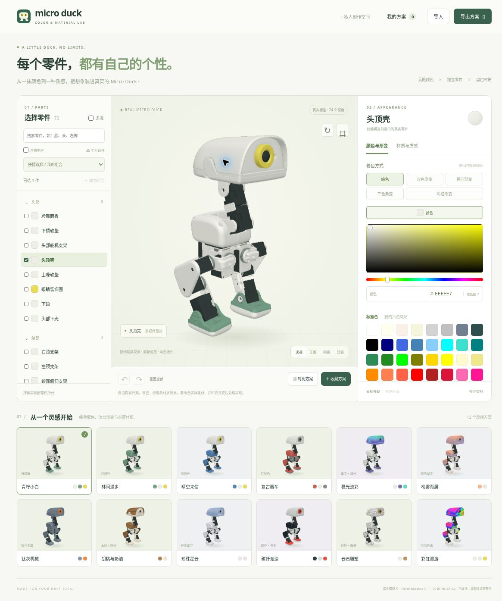
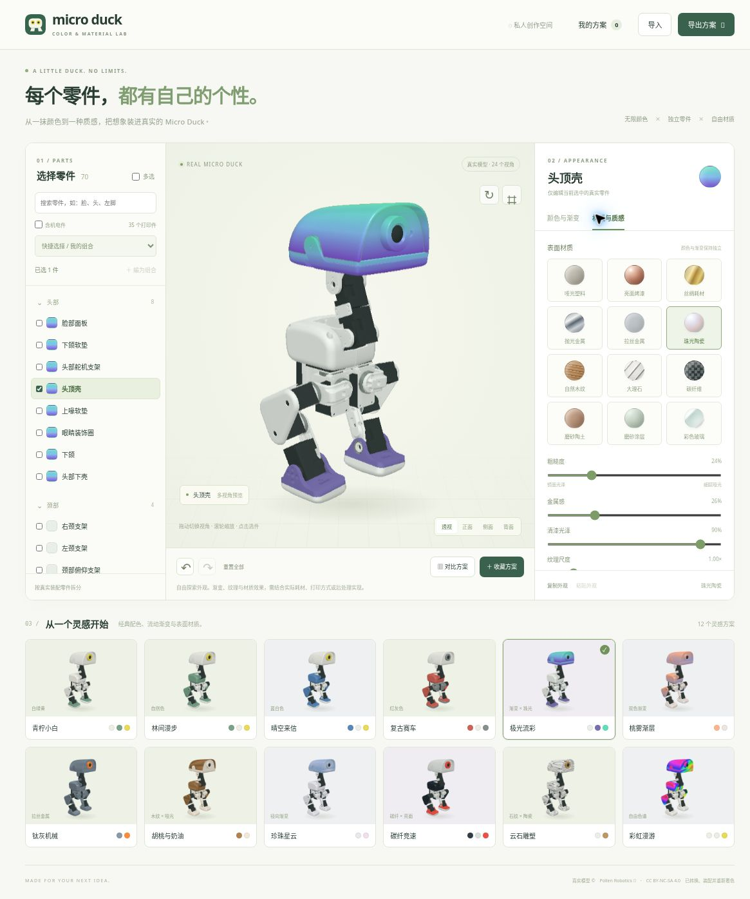

<p align="center"></p>

<h1 align="center">Micro Duck Color Studio</h1>

<p align="center"><strong>A little duck. Endless possibilities.</strong><br>
Explore colors, gradients, and materials on the real Micro Duck, one part at a time.</p>

<p align="center">
  
  
  
  
</p>

<p align="center">
  <a href="https://xujiayuxian-png.github.io/microduck-color-studio/">🚀 Try it live</a> ·
  <a href="README.zh-CN.md">简体中文</a> ·
  <a href="#-quick-start">Run locally</a> ·
  <a href="THIRD_PARTY_NOTICES.md">Attribution & licenses</a>
</p>



<p align="center"><em>Pick a part. Find your color. Make it yours.</em></p>

A browser-based design playground built from Pollen Robotics’ official Microduck geometry and assembly descriptions. Try a practical filament palette, invent a new finish, and compare your favorite combinations before printing.

## 📸 A closer look

<details>
<summary><strong>🌈 Gradients meet materials: Aurora + pearl ceramic</strong></summary>



The same parts, a completely different personality. Mix gradient colors with a surface finish, then adjust the details.

</details>

Screenshots show the earlier 12-preset interface, before the neutral-lighting and 20-preset update. Captured from the live application on 2026-11-12 using its **24-view compatibility renderer**. These are real UI captures, not mockups; WebGL material appearance may differ. Robot geometry and derived views © [Pollen Robotics](https://github.com/pollen-robotics/microduck_rl), [CC BY-NC-SA 4.0](https://creativecommons.org/licenses/by-nc-sa/4.0/). See [screenshot provenance](docs/images/README.md).

## ✨ Features

- **Independent parts.** Customize 70 assembly instances, with 35 printable parts shown by default. The face, upper and lower head shells, eyes, hip connectors, left and right feet, and sole plates remain separately editable. Search by part name or STL filename.
- **Any color you like.** Start with 40 standard CSS/sRGB colors, use the HSV palette or native color picker, or enter a HEX value. A filament tab keeps white, green, lemon yellow, blue, red, and gray close at hand.
- **Five paint modes.** Solid, two-color linear, three-color, radial, and rainbow gradients, with adjustable stops and direction.
- **Twelve material looks.** Matte plastic, glossy paint, silk filament, polished and brushed metal, pearl ceramic, wood, marble, carbon fiber, clay, frosted coating, and colored glass. Tune roughness, metalness, clearcoat, and texture scale.
- **Flexible selections.** Edit a single part, multi-select, use a quick group, or save a named custom group. Batch edits preserve appearance properties you did not change.
- **Compare and keep ideas.** Explore 20 presets with material filtering, save up to eight local favorites, compare schemes side by side, undo/redo, and export a PNG appearance sheet or a complete JSON configuration.
- **Color reference mode.** Neutral studio lighting is the default. Toggle color reference mode to remove lighting, reflection, and transparency effects while retaining colors and textures. This checks screen color values, not physical print color accuracy.
- **Two preview paths.** WebGL2 renders physical materials. A compatibility renderer uses 24 views generated from the same geometry and supports per-part colors, gradients, and procedural textures.

## 🚀 Quick start

Clone the repository and serve the static app with Python 3:

```sh
git clone https://github.com/xujiayuxian-png/microduck-color-studio.git
cd microduck-color-studio
python3 -m http.server 8080 --bind 127.0.0.1 --directory dist
```

Open **http://127.0.0.1:8080/** in your browser. No frontend dependency installation or build step is required. If Node.js is installed, `npm run dev` starts the same Python server.

The complete static application is in `dist/`. Serve that directory over HTTP rather than opening `index.html` as a local file.

The current live demo is hosted on GitHub Pages. The [Pages workflow](.github/workflows/pages.yml) publishes `dist/` when a push to `main` changes `dist/**` or the workflow itself; it can also be started manually. Documentation-only changes do not trigger deployment. The earlier ChatGPT Sites copy is separate and is not synchronized by this workflow.

## 🎨 A simple workflow

1. Choose a preset or start with your available filaments.
2. Select a part from the model or part list. Enable multi-selection or create a group when several parts should share a finish.
3. Adjust colors, gradient stops, and material properties; the preview updates immediately.
4. Save promising combinations and compare them side by side.
5. Export JSON to keep an editable scheme, or PNG to share an appearance reference.

Configurations, groups, and favorites are stored in the current browser’s LocalStorage. Export JSON to transfer a scheme to another browser or device. There is no application backend or account system.

## 🔎 Preview limitations

This is an appearance planning tool. Gradients and material finishes do not generate slicer settings, toolpaths, or manufacturing instructions. Actual results depend on filament, lighting, print settings, and post-processing.

The compatibility renderer approximates glass and reflective materials. Some internal parts are hidden by the assembled structure but remain editable. The automated browser environment used for validation did not provide WebGL, so GPU material rendering has not been validated end to end. Native file-picker automation was also incomplete; JSON import processing is covered by unit tests.

## 🧪 Development and verification

JavaScript tests require **Node.js 20+**:

```sh
npm test
```

Python asset tests and regeneration scripts require the development dependencies:

```sh
python3 -m venv .venv
. .venv/bin/activate
python -m pip install -r requirements-dev.txt
python -m unittest discover -s tests -p '*_test.py'
```

The 2026-11-13 update passed **21 JavaScript tests and eight Python tests**. They cover independent part editing, configuration migration, gradient and texture sampling, group restoration, history isolation, geometry coordinates, and surface-map assets. Browser checks cover separate face/head colors, independent feet, gradients and materials, favorites, comparison, exports, undo, and mobile layout.

## 🗂️ Project layout

| Path | Purpose |
| --- | --- |
| `dist/index.html`, `dist/style.css` | App shell and responsive layout |
| `dist/studio.mjs` | Editor, selections, groups, history, favorites, import/export |
| `dist/studio-state.mjs` | Appearance state, validation, presets, migration |
| `dist/paint.mjs` | Shared gradient/texture sampling and shader logic |
| `dist/viewer-v2.mjs` | Three.js WebGL2 physical-material preview |
| `dist/fallback-v2.mjs` | 24-view compatibility renderer |
| `dist/geometry.mjs` | Geometry-based assembly normalization |
| `dist/assets/` | Converted geometry, part catalog, and surface maps |
| `dist/vendor/` | Bundled Three.js modules and license |
| `reference/` | Assembly descriptions and asset-generation tools |
| `tests/` | State, paint, geometry, and asset checks |

## 🦆 Model provenance and asset regeneration

The robot geometry comes from [Pollen Robotics’ microduck_rl](https://github.com/pollen-robotics/microduck_rl), pinned to commit `0daab160d3fb1c2cbaba16a4a19052f36709dd9e`. The app assembles 38 geometry meshes into 70 addressable instances in the official standing pose. Source and conversion details are recorded in [`dist/assets/ATTRIBUTION.md`](dist/assets/ATTRIBUTION.md) and `dist/assets/duck.json`.

All runtime assets are included. To regenerate surface maps from the bundled geometry, install the Python development dependencies and use a C++17 compiler:

```sh
python reference/prepare_raster.py
g++ -std=c++17 -O3 reference/raster.cpp -o reference/raster
./reference/raster
python reference/export_views.py
python tests/parts_assets_test.py
```

See [`reference/RASTER_CHANNELS.md`](reference/RASTER_CHANNELS.md) for the map encoding. `reference/build_model.py` can fetch the pinned upstream STL assets and rebuild the geometry package; run the surface-map pipeline afterward to restore the part metadata and views.

## 📜 Attribution and licensing

This is an independent project based on Microduck assets, with no claimed affiliation or endorsement from Pollen Robotics.

- **Model geometry and derived views:** CC BY-NC-SA 4.0, including its noncommercial and share-alike conditions.
- **Upstream assembly descriptions:** Apache-2.0, as documented by the source project.
- **Three.js and bundled helpers:** MIT; the license is included in `dist/vendor/THREE-LICENSE.txt`.
- **Application-specific code:** no additional open-source license has been selected. Public repository visibility does not change the applicable licenses.

See [THIRD_PARTY_NOTICES.md](THIRD_PARTY_NOTICES.md) for scope and attribution. Please preserve the notices when redistributing covered assets.
