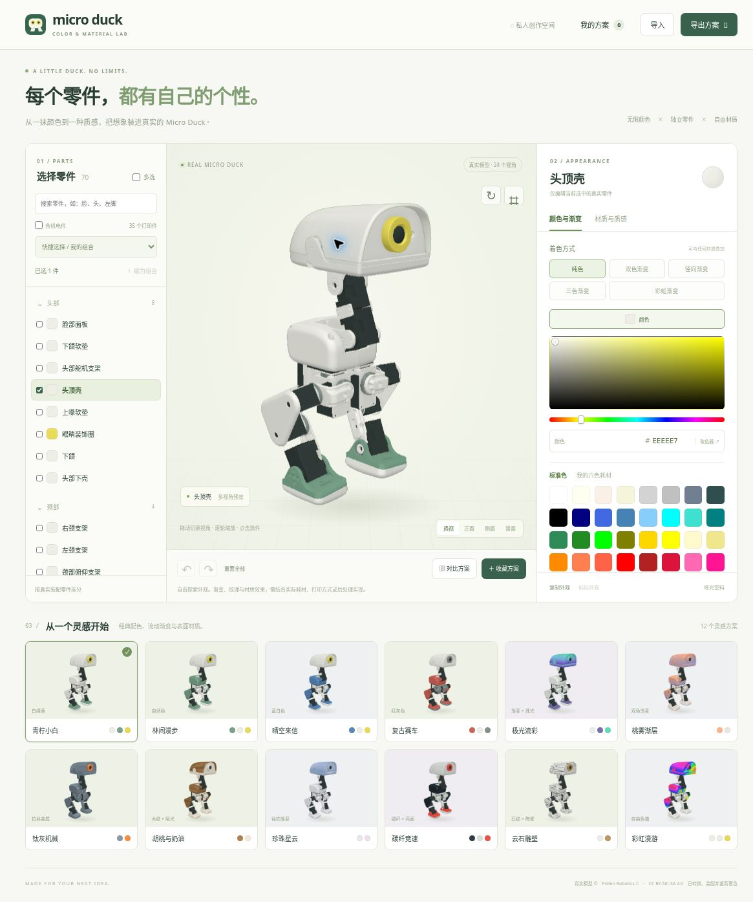
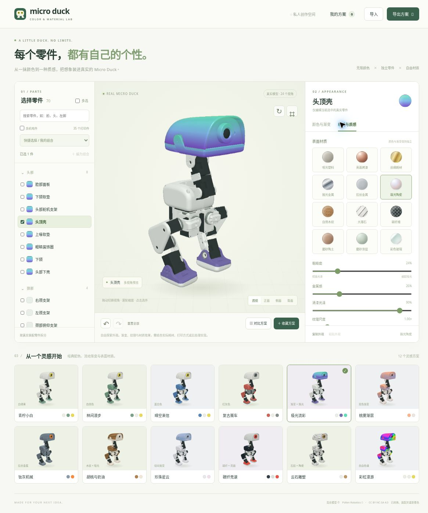

<p align="center"></p>

<h1 align="center">Micro Duck 自由配色与材质实验室</h1>

<p align="center"><strong>每个零件，都有自己的个性。</strong><br>从一抹颜色到一种质感，把想象装进真实的 Micro Duck。</p>

<p align="center">
  
  
  
  
</p>

<p align="center">
  <a href="https://xujiayuxian-png.github.io/microduck-color-studio/">🚀 在线体验</a> ·
  <a href="README.md">English</a> ·
  <a href="#-本地运行">本地运行</a> ·
  <a href="THIRD_PARTY_NOTICES.md">来源与许可</a>
</p>



<p align="center"><em>选中零件，找到颜色，做出属于你的那一只。</em></p>

基于 Pollen Robotics 官方 Microduck 几何与装配描述的静态网页工具。可以给每个真实零件分别设置颜色、渐变与表面材质，再收藏、比较并导出搭配方案。

## 📸 界面一览

<details>
<summary><strong>🌈 渐变 × 材质：极光流彩与珠光陶瓷</strong></summary>



同一组零件，也可以有完全不同的个性。渐变与表面材质自由叠加，再细调每一处质感。

</details>

截图展示的是中性光照与 20 组预设更新前的旧版界面。截图于 2026-11-12 从实际运行的网页获取，使用 **24 视角兼容渲染器**，不是效果图；WebGL 材质外观可能有所不同。机器人几何及衍生视图 © [Pollen Robotics](https://github.com/pollen-robotics/microduck_rl)，遵循 [CC BY-NC-SA 4.0](https://creativecommons.org/licenses/by-nc-sa/4.0/)。详见[截图来源说明](docs/images/README.md)。

## ✨ 功能

- **逐件编辑**：70 个独立装配件，默认显示 35 个打印件；脸部面板、头顶壳、头部下壳、左右脚、踝部和脚底板分别可调。可按名称或 STL 文件名搜索。
- **自由选色**：40 种 CSS / sRGB 常用标准色、HSV 调色盘、系统取色器和任意 HEX 色值，同时保留白、绿、柠檬黄、蓝、红、灰六种耗材快捷选择。
- **渐变**：纯色、双色渐变、三色渐变、径向渐变和彩虹渐变；可分别调整色标和方向。
- **材质**：哑光塑料、亮面烤漆、丝绸耗材、抛光金属、拉丝金属、珠光陶瓷、木纹、大理石、碳纤维、陶土、磨砂涂层和彩色玻璃，可调整粗糙度、金属感、清漆光泽和纹理尺度。
- **组合编辑**：单件、多选、快捷组合和自定义命名组合；批量修改只更新所选属性，保留各零件的其他外观设置。
- **方案管理**：20 组灵感预设与材质筛选、8 个本地收藏、并排比较、撤销与重做、PNG 外观清单以及完整 JSON 方案导出／导入。
- **原色核对**：默认采用中性工作室光照；切换原色核对可移除光照、反射与透明度影响，同时保留颜色和纹理。它用于核对屏幕色值，不代表打印实物校色。
- **兼容预览**：支持 WebGL2 时使用物理材质；无 WebGL 时使用同一真实几何生成的 24 视角表面图，仍支持逐件渐变与纹理编辑。

## 🚀 本地运行

不需要安装前端依赖，也不需要构建。使用 Python 3 从仓库根目录启动 HTTP 服务：

```sh
python3 -m http.server 8080 --bind 127.0.0.1 --directory dist
```

然后打开 `http://127.0.0.1:8080/`。也可以在安装 Node.js 后执行 `npm run dev`，它使用同一条 Python 启动命令。

`dist/` 是完整可运行的静态站点，可以放到你选择的静态服务器。当前在线演示托管于 GitHub Pages；[Pages 工作流](.github/workflows/pages.yml) 会在推送到 `main` 且修改了 `dist/**` 或工作流本身时发布 `dist/`，也支持手动触发。只修改文档不会触发部署。原来的 ChatGPT Sites 副本独立托管，不会由此工作流同步更新。

颜色设置、自定义组合与收藏保存于当前浏览器的 LocalStorage，不上传服务器。可用 JSON 导出保存完整参数，换设备后重新导入。

## 🧪 验证

JavaScript 测试需要 Node.js 20 或更新版本：

```sh
node --test tests/*.test.mjs
```

Python 测试和模型处理脚本使用以下依赖：

```sh
python3 -m venv .venv
. .venv/bin/activate
python -m pip install -r requirements-dev.txt
python -m unittest discover -s tests -p '*_test.py'
```

2026-11-13 的更新通过 **21 项 JavaScript 测试与 8 项 Python 测试**，覆盖独立零件编辑、旧方案迁移、渐变与纹理采样、组合恢复、深拷贝历史、真实几何坐标一致性及全部表面图数据。

浏览器实测包括脸／头壳异色、左右脚独立配色、渐变叠加珠光、组合材质修改、收藏比较与恢复、PNG／JSON 导出、调色盘和撤销，以及手机宽度布局。测试环境未启用 WebGL，因此实际 GPU 材质渲染未完成端到端验证；原生文件选择器的自动化测试也未完成，导入数据处理逻辑已有单元测试。

## 🗂️ 项目结构

| 路径 | 内容 |
| --- | --- |
| `dist/index.html`、`dist/style.css` | 页面与响应式布局 |
| `dist/studio.mjs` | 编辑、选择、组合、历史、收藏和导入导出 |
| `dist/studio-state.mjs` | 外观参数、校验、预设、迁移和状态快照 |
| `dist/paint.mjs` | 共享渐变／纹理采样及物理材质着色函数 |
| `dist/viewer-v2.mjs` | WebGL2 物理材质预览 |
| `dist/fallback-v2.mjs` | 24 视角兼容渲染 |
| `dist/geometry.mjs` | 与真实零件边界一致的装配归一化 |
| `dist/state.mjs` | 旧版六色方案兼容定义 |
| `dist/assets/` | 原始几何转换包、独立零件目录和表面图 |
| `dist/vendor/` | 本地 Three.js、控制器及其许可证 |
| `reference/` | 官方装配 XML、模型转换和 CPU 表面图生成脚本 |
| `tests/` | 状态、采样、几何和资源测试 |

## 🦆 模型来源与重新生成

模型来源为 [Pollen Robotics microduck_rl](https://github.com/pollen-robotics/microduck_rl)，精确提交与转换信息在 `dist/assets/duck.json` 和 `dist/assets/ATTRIBUTION.md` 中记录。38 个几何网格按官方站立姿态装配为 70 个独立可寻址零件，未重新设计机器人外形。

仓库已包含运行所需资源，不必重新下载 STL。若要从现有几何包重新生成表面图，在仓库根目录执行以下命令；需要 Python 开发依赖与支持 C++17 的编译器：

```sh
python reference/prepare_raster.py
g++ -std=c++17 -O3 reference/raster.cpp -o reference/raster
./reference/raster
python reference/export_views.py
python tests/parts_assets_test.py
```

表面图编码详见 `reference/RASTER_CHANNELS.md`。`reference/build_model.py` 可从固定的官方源提交重新获取 STL 并转换几何包；之后需要继续执行上述流程，恢复独立零件元数据和表面图。生成中间文件与缓存不纳入版本控制。

## 📜 材质与版权说明

渐变、纹理和材质是外观设计预览，实际成品取决于耗材、打印方式与后处理。兼容预览中的玻璃、金属反射属于近似效果。少数内部零件被装配结构遮挡，但仍可单独设置。

模型及衍生视图遵循 **CC BY-NC-SA 4.0**，包含非商业限制；Three.js 遵循 MIT 许可证。详细归属及适用范围见 [THIRD_PARTY_NOTICES.md](THIRD_PARTY_NOTICES.md)。
